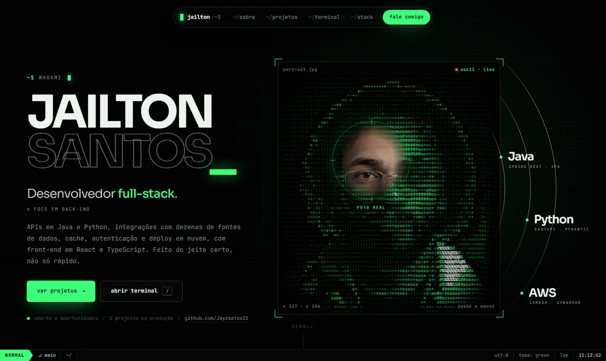
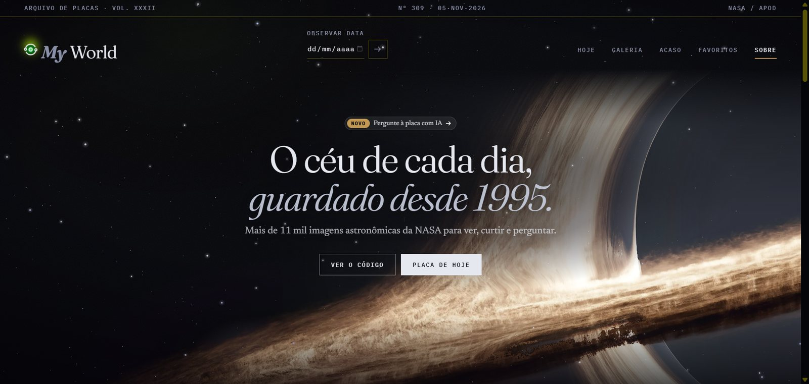

<div align="center">

<a href="https://jayzmatos22.github.io/portifolio/">
  
</a>

<br/>

<a href="https://jayzmatos22.github.io/portifolio/"></a>
<a href="https://www.linkedin.com/in/jailton-santos-b149752a0"></a>


</div>


<h2></h2>

```
Jailton, 24 anos. Desenvolvedor full-stack com foco em back-end,
em busca de estágio ou oportunidade júnior.

formação → Análise e Desenvolvimento de Sistemas · Unisa (previsão jul/2027)
foco     → APIs, integrações, cache, autenticação e deploy em nuvem
agora    → Java + Spring Boot e Python + FastAPI, do banco ao deploy
```

<h2></h2>



<h2></h2>

### `01` Portfólio terminal

<a href="https://jayzmatos22.github.io/portifolio/"></a>
<a href="https://jayzmatos22.github.io/portifolio/"></a>

<p align="center">
  <a href="https://jayzmatos22.github.io/portifolio/"></a>
  <a href="https://github.com/Jayzmatos22/portifolio"></a>
</p>

**Este portfólio: um site em tema de terminal, com retrato em ASCII ao vivo, shell interativo e galeria 3D dos projetos.**
O visitante pode digitar `help`, `neofetch` ou `galeria myworld`, arrastar as telas dos projetos num arco em perspectiva
e ver a foto real por uma lente que passeia pelo retrato.

|  |  |
|---|---|
| **Front-end** | TypeScript (strict) · Vite 8 · GSAP (ScrollTrigger + SplitText) · Lenis · Canvas 2D · CSS 3D |
| **Qualidade** | Vitest · 65 testes · cobertura v8 · TDD na lógica pura |
| **CI/CD** | GitHub Actions (testes e build em todo PR) · GitHub Pages |

<div align="center">

`65 testes` &nbsp;·&nbsp; `20 comandos no terminal` &nbsp;·&nbsp; `2 dependências` &nbsp;·&nbsp; `~75 KB gzip`

</div>

Três decisões que valem mais que a lista de tecnologias:

- **Lógica pura fora do DOM.** O parser e o autocomplete do terminal, a matemática do retrato ASCII e a geometria
  do arco 3D são funções puras, escritas com TDD. A interface só desenha o que elas calculam.
- **Um único loop de animação.** Retrato, canvases e galeria rodam no ticker do GSAP, pausam fora da tela e
  respeitam `prefers-reduced-motion`.
- **Sem framework de UI.** TypeScript strict + Vite, 2 dependências de produção e ~75 KB de JS. Todo PR roda
  testes e build antes de entrar.


### `02` MyWorld

<a href="https://d3qm8fzq1hw1xt.cloudfront.net/"></a>
<a href="https://d3qm8fzq1hw1xt.cloudfront.net/"></a>

<p align="center">
  <a href="https://d3qm8fzq1hw1xt.cloudfront.net/"></a>
  <a href="https://github.com/Jayzmatos22/MyWorld"></a>
</p>

**A Astronomy Picture of the Day da NASA, desde 1995, num arquivo editorial com IA que responde sobre cada imagem.**
Cada dia vira uma "placa": imagem ou vídeo em destaque, explicação original e dados da observação. Dá para navegar
por qualquer data, ver intervalos lado a lado, sortear placas, curtir as favoritas e perguntar a uma IA sobre o que
aparece na imagem. Tudo roda na AWS sem servidor fixo, dentro do nível gratuito.

|  |  |
|---|---|
| **Backend** | Python 3.13 · FastAPI · Pydantic v2 · SDK `openai` (NVIDIA, Groq, Google) · boto3 |
| **Frontend** | React 19 · TypeScript · Vite 7 · Tailwind 4 · React Router 7 · WebGL |
| **Cloud** | AWS Lambda (SAM) · DynamoDB · S3 + CloudFront · CloudWatch + SNS |
| **Fonte** | NASA APOD (`science.nasa.gov`) |

<div align="center">

`11 mil+ placas` &nbsp;·&nbsp; `3 provedores de IA` &nbsp;·&nbsp; `US$ 0 de AWS` &nbsp;·&nbsp; `0 rastreadores`

</div>

Três decisões que valem mais que a lista de tecnologias:

- **IA que não inventa contexto.** O cliente manda só a data; o servidor busca a explicação da NASA
  e é ela que vai para o modelo. Ninguém consegue trocar o contexto pelo navegador.
- **Rate limit sem guardar IP.** Contadores no DynamoDB com o IP transformado em HMAC (IPv6 conta pelo `/64`)
  e um disjuntor de custo: tráfego anormal põe a API em concorrência zero, e a conta não cresce.
- **Buraco negro em WebGL.** Um shader faz os anéis girarem e o disco correr sobre a foto, com o centro parado;
  a imagem de 7,5 MB chega ao celular com 45 KB.


### `03` Brasil Panel

<a href="https://brasilpanel.com.br"></a>
<a href="https://brasilpanel.com.br"></a>

<p align="center">
  <a href="https://brasilpanel.com.br"></a>
  <a href="https://github.com/Jayzmatos22/brasil_panel_utilities-api"></a>
</p>

**Painel de indicadores econômicos do Brasil, a partir de 12 fontes oficiais.**
Não é agregador de links: cada série passa pelo backend, que normaliza o formato, guarda histórico em PostgreSQL
e serve o frontend a partir de um cache dimensionado pela cadência de cada fonte — é o que permite abrir uma página
com quinze gráficos sem estourar a cota de nenhuma API.

|  |  |
|---|---|
| **Backend** | Java 21 · Spring Boot 3.5 · Spring Security · PostgreSQL 18 + Flyway · Caffeine |
| **Frontend** | React 19 · TypeScript · Vite 8 · Tailwind 4 · TanStack Query · ECharts |
| **Deploy** | Vercel · Render (Docker) · Neon |
| **Fontes** | BCB · IPEA · IBGE · SIDRA · World Bank · Frankfurter · Alpha Vantage · Metals.dev · CoinGecko · CoinMarketCap · BrasilAPI · ViaCEP |

<div align="center">

`96 endpoints` &nbsp;·&nbsp; `23 tabelas` &nbsp;·&nbsp; `77 caches` &nbsp;·&nbsp; `26 rotas`

</div>

Três decisões que valem mais que a lista de tecnologias:

- **JWT em cookie `HttpOnly`, sem CORS.** O rewrite da Vercel mantém front e API na mesma
  origem, então o token fica inacessível ao JavaScript — imune a exfiltração por XSS.
- **Logout que revoga de verdade.** JWT é stateless: sair só apagava o cookie e o token
  seguia válido por 24h. Resolvido com denylist por `jti`, sem derrubar os outros aparelhos.
- **Cache em duas camadas.** O do cliente economiza rede para um usuário; o do servidor
  economiza cota para todos. São problemas diferentes.

<h2></h2>

#### Back-end & full-stack

| Projeto | Stack | Destaque |
|---|---|---|
| **[Spring Security JWT](https://github.com/Jayzmatos22/Full-Stack-Spring-Security-study)** | Java • Spring Boot • Spring Security • JWT • H2 | Autenticação stateless completa |
| **[Financial System](https://github.com/Jayzmatos22/Complete-banking-system---POO-Python)** | Python • MySQL • POO | MVC + transações seguras + `@property` |
| **[Movie Zone](https://github.com/Jayzmatos22/Movie-Zone-Platform-for-creating-movie-playlists.)** | Java • Spring Boot • JPA • MySQL | MVC + injeção de dependências |
| **[Cadastro de Alunos](https://github.com/Jayzmatos22/full_stack_java_register_system)** | Java • Spring Boot • MySQL | Integração ponta a ponta |

#### Front-end

| Projeto | Stack | Destaque |
|---|---|---|
| **[Nexus Shop](https://github.com/Jayzmatos22/Nexus-shop-eccomerce)** | React • TS • Tailwind • Vite | Custom Events + LocalStorage + tipagem |
| **[Inventário Pro](https://github.com/Jayzmatos22/Invent-rio-Pro-front-end-js)** | JS • Tailwind • HTML5 | DOM dinâmico + componentização |
| **[Task Master](https://github.com/Jayzmatos22/Task-Master-react)** | React • Tailwind | Foco em UI/UX e performance |

<h2></h2>

<div align="center">
  
  <br/><br/>
  
  <br/><br/>
  
</div>

<h2></h2>

<p align="center">
  <a href="https://jayzmatos22.github.io/portifolio/"></a>
  <a href="https://www.linkedin.com/in/jailton-santos-b149752a0"></a>
  <a href="mailto:jailtonmatos200@gmail.com"></a>
</p>

<div align="center">
  <br/>
  <code>~$ echo "Não sou gênio, sou PERSISTENTE."</code>
  <br/><br/>
  
</div>
