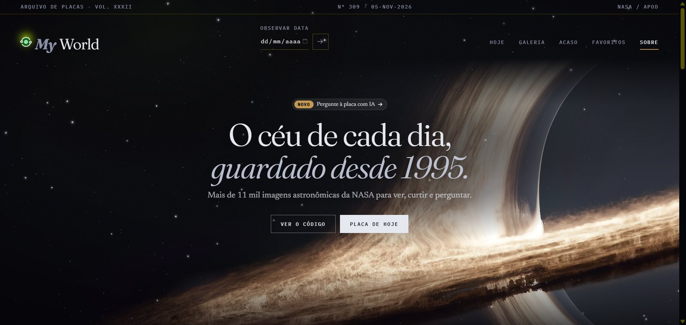

<div align="center">
  

  <a href="https://www.linkedin.com/in/jailton-santos-b149752a0">
    
  </a>
  
  

  <br/><br/>


</div>

---

### 👨‍💻 Sobre mim

```
Jailton, 24 anos. Desenvolvedor fullstack com foco em back-end,
em busca de estágio ou oportunidade low/mid level.

Stack principal: Java · Spring Boot · Python · FastAPI · React + Tailwind CSS · AWS
```

---

### 🛠️ Stack

<table>
  <tr>
    <td align="center" width="140"><b>Backend</b></td>
    <td></td>
  </tr>
  <tr>
    <td align="center"><b>Frontend</b></td>
    <td></td>
  </tr>
  <tr>
    <td align="center"><b>Banco de Dados</b></td>
    <td></td>
  </tr>
  <tr>
    <td align="center"><b>Cloud & DevOps</b></td>
    <td></td>
  </tr>
  <tr>
    <td align="center"><b>Ferramentas</b></td>
    <td></td>
  </tr>
</table>

---

## ⭐ Projetos em destaque

<div align="center">

<h3>🌌 MyWorld</h3>

<a href="https://d3qm8fzq1hw1xt.cloudfront.net/">
  
</a>
<a href="https://github.com/Jayzmatos22/MyWorld">
  
</a>

<br/><br/>

<a href="https://d3qm8fzq1hw1xt.cloudfront.net/">
  
</a>

<br/><br/>

<p><b>A Astronomy Picture of the Day da NASA, desde 1995, num arquivo editorial com IA que responde sobre cada imagem.</b></p>

</div>

Cada dia vira uma "placa": imagem ou vídeo em destaque, explicação original e dados da observação.
Dá para navegar por qualquer data, ver intervalos lado a lado, sortear placas, curtir as favoritas
e perguntar a uma IA sobre o que aparece na imagem. Tudo roda na AWS sem servidor fixo, dentro do nível gratuito.

|  |  |
|---|---|
| **Backend** | Python 3.13 · FastAPI · Pydantic v2 · SDK `openai` (NVIDIA, Groq, Google) · boto3 |
| **Frontend** | React 19 · TypeScript · Vite 7 · Tailwind 4 · React Router 7 · WebGL |
| **Cloud** | AWS Lambda (SAM) · DynamoDB · S3 + CloudFront · CloudWatch + SNS |
| **Fonte** | NASA APOD (`science.nasa.gov`) |

<div align="center">

`11 mil+ placas` &nbsp;·&nbsp; `3 provedores de IA` &nbsp;·&nbsp; `US$ 0 de AWS` &nbsp;·&nbsp; `0 rastreadores`


</div>

Três decisões que valem mais que a lista de tecnologias:

- **IA que não inventa contexto.** O cliente manda só a data; o servidor busca a explicação da NASA
  e é ela que vai para o modelo. Ninguém consegue trocar o contexto pelo navegador.
- **Rate limit sem guardar IP.** Contadores no DynamoDB com o IP transformado em HMAC (IPv6 conta pelo `/64`)
  e um disjuntor de custo: tráfego anormal põe a API em concorrência zero, e a conta não cresce.
- **Buraco negro em WebGL.** Um shader faz os anéis girarem e o disco correr sobre a foto, com o centro parado;
  a imagem de 7,5 MB chega ao celular com 45 KB.

---

<div align="center">

<h3>🇧🇷 Brasil Panel</h3>

<a href="https://brasilpanel.com.br">
  
</a>
<a href="https://github.com/Jayzmatos22/brasil_panel_utilities-api">
  
</a>

<br/><br/>

<a href="https://brasilpanel.com.br">
  
</a>

<br/><br/>

<p><b>Painel de indicadores econômicos do Brasil, a partir de 12 fontes oficiais.</b></p>

</div>

Não é agregador de links: cada série passa pelo backend, que normaliza o formato,
guarda histórico em PostgreSQL e serve o frontend a partir de um cache dimensionado
pela cadência de cada fonte — é o que permite abrir uma página com quinze gráficos
sem estourar a cota de nenhuma API.

|  |  |
|---|---|
| **Backend** | Java 21 · Spring Boot 3.5 · Spring Security · PostgreSQL 18 + Flyway · Caffeine |
| **Frontend** | React 19 · TypeScript · Vite 8 · Tailwind 4 · TanStack Query · ECharts |
| **Deploy** | Vercel · Render (Docker) · Neon |
| **Fontes** | BCB · IPEA · IBGE · SIDRA · World Bank · Frankfurter · Alpha Vantage · Metals.dev · CoinGecko · CoinMarketCap · BrasilAPI · ViaCEP |

<div align="center">

`96 endpoints` &nbsp;·&nbsp; `23 tabelas` &nbsp;·&nbsp; `77 caches` &nbsp;·&nbsp; `26 rotas`


</div>

Três decisões que valem mais que a lista de tecnologias:

- **JWT em cookie `HttpOnly`, sem CORS.** O rewrite da Vercel mantém front e API na mesma
  origem, então o token fica inacessível ao JavaScript — imune a exfiltração por XSS.
- **Logout que revoga de verdade.** JWT é stateless: sair só apagava o cookie e o token
  seguia válido por 24h. Resolvido com denylist por `jti`, sem derrubar os outros aparelhos.
- **Cache em duas camadas.** O do cliente economiza rede para um usuário; o do servidor
  economiza cota para todos. São problemas diferentes.

---

### 🔭 Outros projetos

#### ⚙️ Backend & Full-Stack

| Projeto | Stack | Destaque |
|---|---|---|
| **[🔐 Spring Security JWT](https://github.com/Jayzmatos22/Full-Stack-Spring-Security-study)** | Java • Spring Boot • Spring Security • JWT • H2 | Autenticação stateless completa |
| **[💰 Financial System](https://github.com/Jayzmatos22/Complete-banking-system---POO-Python)** | Python • MySQL • POO | MVC + transações seguras + `@property` |
| **[🍿 Movie Zone](https://github.com/Jayzmatos22/Movie-Zone-Platform-for-creating-movie-playlists.)** | Java • Spring Boot • JPA • MySQL | MVC + injeção de dependências |
| **[🎓 Cadastro de Alunos](https://github.com/Jayzmatos22/full_stack_java_register_system)** | Java • Spring Boot • MySQL | Integração ponta a ponta |

#### 🎨 Frontend

| Projeto | Stack | Destaque |
|---|---|---|
| **[🛒 Nexus Shop](https://github.com/Jayzmatos22/Nexus-shop-eccomerce)** | React • TS • Tailwind • Vite | Custom Events + LocalStorage + tipagem |
| **[📦 Inventário Pro](https://github.com/Jayzmatos22/Invent-rio-Pro-front-end-js)** | JS • Tailwind • HTML5 | DOM dinâmico + componentização |
| **[✅ Task Master](https://github.com/Jayzmatos22/Task-Master-react)** | React • Tailwind | Foco em UI/UX e performance |

---

### 📊 GitHub em números

<div align="center">
  
  
</div>

<div align="center">
  
</div>

#### 📈 Atividade

<div align="center">
  
</div>

---

### 🤝 Vamos conversar?

<p align="center">
  <a href="https://www.linkedin.com/in/jailton-santos-b149752a0"></a>
  <a href="mailto:jailtonmatos200@gmail.com"></a>
  <a href="https://github.com/Jayzmatos22"></a>
</p>

---

<div align="center">
  
  <br/>
  <i>"Não sou gênio, sou PERSISTENTE."</i>
  <br/><br/>
  
</div>
